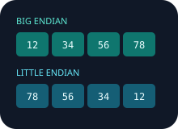

## 🧭 Overview

A dependency-free Node.js CLI that demonstrates how a 32-bit integer is stored as bytes in big-endian and little-endian order, and how <code>DataView</code> interprets those bytes.

## ✨ Features

- 🔢 Inspect any unsigned 32-bit integer.
- 🧱 Compare big-endian and little-endian byte sequences.
- 🔍 Read each sequence using both byte-order settings.
- 📦 Print JSON for scripts and lessons.

## 🎬 Demo

No hosted demo is provided. The default value is <code>0x12345678</code>, which produces the byte sequences <code>12 34 56 78</code> and <code>78 56 34 12</code>.

## ⚡ Quick Start

Requires Node.js 18+. No dependencies are needed.

~~~bash
npm start
npm start -- --value 305419896
npm test
~~~

## 🧰 Tech Stack

- Node.js 18+
- <code>ArrayBuffer</code> and <code>DataView</code>
- Node.js built-in test runner

## 🗂️ Folder Structure

~~~text
buffer-endianness-lab/
├── src/main.js
├── test/main.test.js
├── package.json
├── assets/mark.svg
├── .gitignore
├── LICENSE
└── README.md
~~~

## 🗺️ Roadmap

- [x] 32-bit unsigned integer examples
- [x] Both byte orders and cross-reading
- [ ] Add signed integer and floating-point examples

## 🤝 Contributing

Issues and focused pull requests are welcome. Keep examples deterministic and dependency-free.

## 📄 License

MIT License. See [LICENSE](LICENSE).

